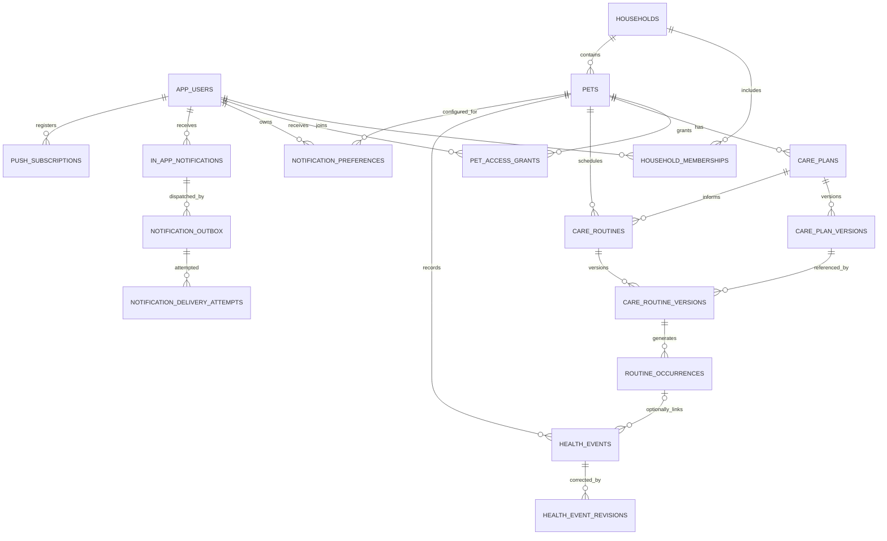

# Pet Health Log — Data Model

**상태:** Phase 0.6 구현 계약. PostgreSQL이 최종 권위 데이터 저장소입니다. 의료 정책·숫자 기본값을 임의 포함하지 않습니다.

## 1. 정규 관계

- 한 Household는 여러 Pet을 포함합니다. 각 Pet은 한 시점에 정확히 하나의 활성 Household에 속합니다.
- Household마다 활성 `PRIMARY_CAREGIVER`가 정확히 한 명입니다. 생성자는 초기 primary가 되며, 마지막 primary는 successor 지정 없이 철회/탈퇴할 수 없습니다. Primary 이전은 role 및 관련 Pet grants를 단일 transaction으로 바꿉니다.
- Membership과 Pet 접근 grant는 분리됩니다. Household membership만으로 Pet의 기록 접근이 자동으로 생기지 않습니다.
- Pet 생성과 초기 primary의 해당 Pet access grant 부여는 하나의 서버 트랜잭션입니다.
- 계정은 복수 Household 멤버십을 가질 수 있습니다. Pet 이전 workflow는 Phase 1 범위가 아닙니다.
- 의료진 접근은 Household membership이 아니라 Pet별 `care_team_links`/grant로만 허용합니다.
- 모든 FK는 tenant 관계의 일관성을 검증합니다. event의 `pet_id`, occurrence의 `pet_id`, occurrence가 참조하는 routine version의 Pet이 일치해야 합니다.

## 2. 핵심 엔터티

| 엔터티 | 최소 필드/제약 | 용도 |
|---|---|---|
| `app_users` | `user_id` = Auth subject PK, 최소 표시 정보 | Auth 참조 |
| `households` | `id`, `name`, `created_by`, UTC timestamps | 공동 돌봄 최상위 그룹 |
| `household_memberships` | `household_id`, `user_id`, `role`, `status`, `invited_at`, `accepted_at`, `revoked_at`; 활성 (household,user) 유일; Household당 활성 primary 정확히 1명 | Household 멤버 관계 |
| `pets` | `id`, `household_id`, `name`, `timezone` (IANA), `created_by`, timestamps | Household의 동물 |
| `pet_access_grants` | `pet_id`, caregiver/read-only `user_id`, role/scope, status, `granted_by`, timestamps | 보호자·읽기 전용 사용자의 Pet별 최소 권한. 의료진은 `care_team_links`만 사용 |
| `care_team_links` | Pet별 clinician principal, scope, invitation/approval/revocation metadata | 의료진 Pet 공유. 자격 검증 여부를 별도 값으로 표현 |
| `care_plans` | `id`, `pet_id`, `plan_type`, timestamps | Care Plan 논리 ID |
| `care_plan_versions` | `id`, `care_plan_id`, `version_no`, source, author, approval status/metadata, `valid_from/to`, content/payload, hash; `(plan_id, version_no)` 유일 | 계획의 불변 버전 |
| `care_routines` | `id`, `pet_id`, required `care_plan_id`, timezone, active range | 반복 일정 정의. 개인 일정도 `USER_ENTERED_UNVERIFIED` 상태의 Care Plan으로 명시적으로 표현 |
| `care_routine_versions` | `id`, `routine_id`, `version_no`, `care_plan_version_id` 필수, recurrence, ordered steps/prerequisites, valid range | 특정 plan version을 참조하는 불변 반복 규칙 |
| `routine_occurrences` | `id`, `pet_id`, `routine_version_id`, `care_plan_version_id`, scheduled local date/time, timezone, resolved UTC instant, status, supersedes/cancel metadata | 구체적 예정 슬롯. 실제 행위가 아님 |
| `health_events` | `id`, `pet_id`, `event_type`, `occurred_at`, server `recorded_at`, actor/performer, source, value/unit, optional occurrence/plan version, idempotency reference | 실제 관찰/행위 |
| `health_event_revisions` | `event_id`, revision number, patch/void kind, reason, actor, `recorded_at`, request key | 원본 보존 정정·무효화 |
| `safety_evaluations` | Pet/occurrence, evaluation status, result codes, relevant version/event/revision IDs, `evaluated_at`, evaluator version | 특정 입력 상태의 비의료 데이터 평가 |
| `audit_log` | actor, action, target, UTC time, request/correlation ID, minimal metadata | 권한·기록·계획 주요 행위 추적 |
| `idempotency_records` | actor, operation, key, normalized request hash, response/event ref, created_at; actor/operation/key 유일 | 동일 요청 재전송 보호 |
| `notification_preferences` | Pet/user/type unique, per-channel flags, lead/unconfirmed/repeat interval, quiet hours, timezone | 사용자별 알림 선호; 의료 기준이 아님 |
| `in_app_notifications` | recipient, Pet, type, optional occurrence/event refs, unique dedupe key, generic copy, available/expiry/read/invalidation times | 알림 생성·노출·확인 상태. 읽음은 돌봄 수행이 아님 |
| `notification_outbox` | notification, recipient/Pet, channel, unique idempotency key, status, attempt count, lease, availability/expiry | 서버 전송 대기·claim·완료 상태 |
| `notification_delivery_attempts` | outbox, monotonic attempt number, provider result/error code/message ID, UTC time | 전송 시도 이력; 성공은 사용자 수신/열람 보증이 아님 |
| `push_subscriptions` | user/device endpoint, endpoint hash unique, browser keys, expiry/revocation/success times | 서비스 worker Push endpoint. 본인 전용 RPC와 서버 worker만 읽음 |

Notification 테이블은 Phase 4의 별도 추가 migration으로 관리합니다. attachment와 clinician notes는 현재 범위에서 제외합니다.

알림/outbox는 일정과 실제 event를 대체하지 않습니다. event 생성 후 일정 알림은 무효화되며, 늦은 schedule은 설정된 지연 이후 `RECORD_UNCONFIRMED` 알림만 만들 수 있습니다. 미확인 알림은 실제 미수행을 뜻하지 않습니다. 알림 전송 attempt는 provider ACK에 한정되며 최종 사용자 수신·열람 기록이 아닙니다. 각 Pet/user preference는 채널별로 분리되고, 사용자가 설정을 끄거나 Pet grant가 철회되면 대기 작업은 억제됩니다.

## 3. Care Plan, Care Routine, Occurrence, Event

- `care_plan`은 논리 계획이고 `care_plan_version`은 불변 스냅샷입니다. 계획 수정은 새 version을 만듭니다.
- Plan version은 `source`, `author`, `approval_status`, 승인 메타데이터(해당 시), 유효기간을 가집니다. `clinician_confirmed`는 실제 승인 확인 메타데이터가 있을 때만 사용합니다.
- Care Routine은 반복 일정이며 반드시 Care Plan을 논리적으로 연결합니다. 개인 일정은 별도의 user-entered/unverified Care Plan으로 표현합니다. 각 immutable routine version은 적용할 `care_plan_version_id`를 참조합니다.
- routine version의 순서/선행 조건은 일정 구조입니다. 승인 확인되지 않은 plan을 참조하면 personal/unverified routine이며, 임상 Safety Evaluation의 근거로 쓸 수 없습니다.
- `routine_occurrence`는 계획된 한 슬롯이고 실제 발생 기록이 아닙니다. occurrence는 routine version과 plan version을 고정합니다.
- `health_event`는 관찰/실제 행위이며 routine/plan에 연결되지 않아도 생성할 수 있습니다. 사용자가 선택하거나 서버가 명확히 식별한 경우에만 occurrence를 연결합니다. 시간 근접성만으로 자동 연결하지 않습니다.
- 이미 event가 연결된 occurrence는 수정하지 않습니다. plan/routine 변경으로 미수행 future occurrence가 대체되면 기존 occurrence를 `SUPERSEDED/CANCELLED`로 보존하고 새 version occurrence를 만듭니다.

## 4. 시간·단위

- 모든 실제 순간은 PostgreSQL `timestamptz`/UTC로 저장합니다.
- `occurred_at`은 사용자가 보고한 실제 발생 시각을 UTC instant로 정규화합니다. client wall time, 제출 시 표기 시간대, 서버 수신 `recorded_at`을 별도 둡니다. `recorded_at`은 DB/server가 부여합니다.
- 예약 시각은 `scheduled_local_date`, `scheduled_local_time`, IANA timezone, DST disambiguation/resolved UTC instant를 보존합니다. 사용자 화면은 pet timezone을 기본으로 표시하고 사용자별 표시 전환은 명시적으로 제공합니다.
- 시간대 변경은 과거 시각을 바꾸지 않습니다. 앞으로의 occurrence 생성 설정에 적용합니다.
- DST로 현지 시각이 두 번 발생하면 routine 생성 시 선택된 occurrence/fold 정책에 따라 구체 UTC instant를 고정합니다. 선택 정책이 없는 기존 routine은 임의 선택하지 않습니다.
- DST로 현지 시각이 존재하지 않으면 자동으로 앞/뒤 시간으로 이동하지 않습니다. `SCHEDULE_TIME_UNRESOLVED` occurrence를 만들고 사용자 해소 전 Safety Evaluation은 `NOT_APPLICABLE`로 둡니다.
- DST 처리는 일정 식별 정책일 뿐 의료 투여 간격이나 허용 시간을 추론하는 근거가 아닙니다.
- 측정/수량값은 원값과 단위를 함께 저장합니다. 자동 변환은 원 입력을 덮어쓰지 않습니다. 혈당 등 임상 단위/표시는 수의사 확인 전 해석·범위 판단하지 않습니다.

## 5. Health Event 생성·정정·무효화

### 생성

1. 서버는 Auth principal, 현재 Household membership, 대상 Pet의 활성 grant, event schema를 검증합니다.
2. 클라이언트 idempotency key와 정규화 request hash를 검사합니다.
3. 새 요청은 event를 삽입하고 server `recorded_at`을 부여합니다. client-provided timestamp는 `occurred_at` 후보일 뿐 서버 기록 시각이 아닙니다.
4. 임상적으로 중요한 event 생성과 감사 기록은 같은 DB 트랜잭션에서 커밋합니다.

### 수정·무효화

- 임상 중요 기록은 원행을 직접 UPDATE/DELETE하지 않습니다.
- 정정은 append-only `health_event_revisions`로 저장하고 무효화도 `VOID` revision으로 남깁니다.
- revision은 actor 권한, 원 이벤트 접근, 기대 `revision_no` 또는 version token을 확인해 stale concurrent edit를 거부합니다.
- 조회용 current projection은 revision을 적용해 계산할 수 있지만 원 event와 revision은 보존합니다.
- 일반 기록 정정/무효화는 개인정보 삭제 요청이 아닙니다. 삭제 요청은 별도 접근 검증·정책·감사 경로이며 보존 기간/범위는 미확정입니다.

## 6. 동시 투약·멱등성 계약

- 멱등 scope: `(actor_id, operation, idempotency_key)`. key 재사용 중 body hash가 달라지면 `409 IDEMPOTENCY_KEY_REUSED`.
- occurrence-scoped serialization: 투약 event에 occurrence가 주어지면 서버 트랜잭션은 안정적인 `(pet_id, occurrence_id, event category)` lock key를 직렬화합니다. occurrence가 없으면 추정 슬롯을 만들지 않고 event를 독립 기록하며 경고 평가를 제한합니다.
- lock 획득 후 현재 유효한 접근 grant와 기존 관련 event를 다시 읽습니다.
- 동일 key는 기존 event/응답을 반환합니다. 다른 key의 실제 이벤트는 모두 저장하며 두 번째 이상에 `DUPLICATE_POSSIBLE`를 붙입니다.
- DB unique constraint는 동일 명령의 idempotency record에 적용합니다. 실제 event를 occurrence별 유일하게 제한하는 constraint는 두지 않습니다.
- event, idempotency result, safety result/evidence, audit row는 같은 트랜잭션에서 저장됩니다.
- 권한 실패/멱등성 payload conflict는 event를 생성하지 않습니다.

## 7. 관계형 접근 모델

`household_memberships`는 Household를 관리/참여할 수 있는지를 나타냅니다. `pet_access_grants`는 특정 Pet에 대한 읽기/쓰기 범위를 결정합니다. 보호자 요청은 두 조건을 모두 통과해야 합니다. 의료진은 명시적으로 초대·승인된 Pet별 care-team grant만으로 접근합니다. 서버 명령과 RLS 모두 현재 활성 grant를 확인합니다.

## 8. 감사 및 개인정보 정책 경계

감사 최소 항목: actor, action, target IDs, UTC timestamp, request/correlation ID, result/status, 최소한의 이유 코드. 민감한 event 본문 전체를 audit/log에 복제하지 않습니다. audit row는 일반 앱 사용자에게 UPDATE/DELETE 권한을 주지 않습니다.

개인정보 보존기간, 데이터 처리 지역, DB 및 audit 보존·삭제 요청 적용, 백업 보존/만료, RPO/RTO는 미확정입니다. 책임자·시점·허용 범위·금지 동작은 `IMPLEMENTATION-ROADMAP.md §5`를 따릅니다. 이 결정 전에는 실제 사용자 파일럿이나 영구 보존을 약속하지 않습니다.

## 9. Phase 1 최소 DB 엔터티

1. `app_users` (Auth subject mapping)
2. `households`
3. `household_memberships`
4. `pets`
5. `pet_access_grants`
6. `care_team_links` (관계/status만; 신원 검증·UI 제외)
7. `care_plans`
8. `care_plan_versions`
9. `care_routines`
10. `care_routine_versions`
11. `routine_occurrences`
12. `health_events`
13. `health_event_revisions`
14. `idempotency_records`
15. `audit_log`
16. `safety_evaluations` (최초 schema가 아니라 최소 safety data contract를 확정한 Phase 1 내 포함)

`care_team_links`는 clinician identity 검증 사실과 초대/승인/철회 상태를 저장하는 최소 관계입니다. 실제 clinician account table, 검증 workflow와 관리 UI는 MVP에서 제외 가능합니다. Storage, notification, notes, attachments는 제외합니다.

## 10. 인덱스·제약 기본 계약

- 모든 FK 및 RLS filter key에 적절한 index.
- `(household_id, user_id)` 활성 membership, `(pet_id, user_id)` 활성 보호자 grant 및 `(pet_id, clinician_id)` 활성 care-team link의 조회/유일성 보장.
- Household별 활성 primary membership은 최대 1명 partial unique로 제한하고, Household 생성 및 successor 교체 명령이 활성 primary 정확히 1명 조건을 트랜잭션으로 보장.
- `(plan_id, version_no)` 및 `(routine_id, version_no)` 유일.
- `(pet_id, occurred_at DESC)` 타임라인 index.
- `(pet_id, occurrence_id, event_type)` 조회 index; 실제 이벤트 중복 기록을 금지하는 unique index는 두지 않음.
- `idempotency_records(actor_id, operation, key)` 유일.
- occurrence의 pet, routine version, plan version 연결 일관성은 복합 FK 또는 서버 트랜잭션 검증으로 강제.
- `occurred_at`, `recorded_at`, revision/evaluation/audit 시각은 UTC instant.

